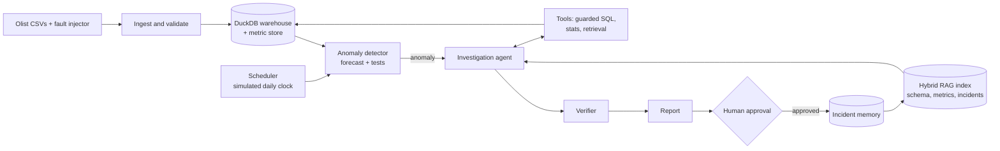

# MetricSentinel

**Autonomous KPI anomaly detection and root-cause investigation, with grounded reports and human approval.**

> **Status: Phase 2 — Data ingestion, validation & EDA (complete).**
> The data pipeline has been run on the real Olist dataset: all hard checks pass and rebuilds are identical.
> The data-quality and EDA findings are in `docs/DATA_PLAN.md` section 14. Anomaly detection, the agent and the
> rest are still *planned*; nothing about them is implemented yet.

---

## Status legend (used in every document)

| Label | Meaning |
|---|---|
| `[MVP]` | Planned for the first end-to-end release (v0.1, end of Phase 6) |
| `[EXT]` | Planned extension after MVP (Phases 7–9, target v1.0) |
| `[FUTURE]` | Idea for after v1.0; not scheduled |
| `[DONE]` | Implemented and verified. **No item carries this label yet.** |

---

## Getting started

**Prerequisites:** [uv](https://docs.astral.sh/uv/), [Docker Desktop](https://www.docker.com/products/docker-desktop/), GNU Make, Git.
uv installs Python 3.12 itself if it is missing (`uv python install 3.12`).

```bash
git clone https://github.com/Shaurya215/MetricSentinel.git
cd MetricSentinel

make setup     # locked dependencies, pre-commit hooks, local .env from .env.example
make lint      # ruff + mypy
make test      # fast unit tests
make up        # Postgres + pgvector, API and UI in Docker; waits until all are healthy
make health    # GET /health  ->  200 {"status": "ok", ...}
```

| Service | URL |
|---|---|
| API health | http://localhost:8000/health |
| API docs (OpenAPI) | http://localhost:8000/docs |
| Review UI (placeholder until Phase 6) | http://localhost:8501 |
| PostgreSQL + pgvector | `localhost:5432` |

Run `make` to list every command. `make eval` is a placeholder that exits with an error until Phase 3.

**Dependency groups.** `uv sync` installs the core runtime plus the `dev` and `data` groups
(DuckDB, pandas, Pandera, holidays, matplotlib). The heavier stacks are opt-in:
`uv sync --group ds` (forecasting, Phase 3) and `uv sync --group agent` (Phases 4–5).

### Build the warehouse (Phase 2)

The Olist dataset is not in the repository. Get it once, in either way:

1. **Manual:** download the zip from <https://www.kaggle.com/datasets/olistbr/brazilian-ecommerce>
   and put it in `data/raw/` (no need to unzip).
2. **Automatic:** create a Kaggle API token (<https://www.kaggle.com/settings> → API), set
   `KAGGLE_USERNAME` and `KAGGLE_KEY` in `.env`.

```bash
make data      # verify files, load, validate, build staging + marts, write the quality report
make eda       # derive the monitoring window, seasonality and sample-size rule from the data
```

The first successful run records the file checksums in `data/raw/checksums.json`. **Commit that file**;
later runs fail loudly if a raw file changes. Outputs: `data/warehouse/warehouse.duckdb` and
`data/reports/quality_report.html|json` (plus `eda_findings.md|json`). Running `make data` twice gives the
same `data_hash` and `warehouse_content_hash`.

No Kaggle account yet? `make data-sample` builds a warehouse from **synthetic (fake) data** under
`data/synthetic/`, to try the pipeline. Its outputs are labelled as fake and are never real results.

---

## 1. Problem

Business teams track KPIs such as orders, revenue, late deliveries and review scores. When a KPI moves unexpectedly, two things usually go wrong:

1. **Detection is late or noisy.** Static thresholds either miss real problems or fire on normal seasonality, so people stop trusting alerts.
2. **Investigation is slow and manual.** An analyst must slice the KPI by state, category, seller and payment type, write many SQL queries, and then explain the result. This takes hours, and the explanation is often not reproducible.

LLM chatbots do not solve this. They answer only when asked, they can invent numbers, and they cannot be trusted to act without review.

## 2. Users

| User | Need |
|---|---|
| Business / operations analyst | Know early when a KPI really changed, and why |
| Data team lead | Trust that numbers in a report came from real queries |
| Approver (manager) | Review a short, evidenced report before anything is shared |
| Portfolio reviewer / interviewer | See ML, Data Science, GenAI and agent engineering working together, with measured results |

## 3. Planned capabilities

| Capability | Status |
|---|---|
| Ingest and validate the Olist e-commerce dataset into a DuckDB warehouse | `[MVP]` |
| Daily KPI metric store (KPIs × dimensions) with a simulated daily clock | `[MVP]` |
| Forecast-based anomaly detection with false-discovery-rate control | `[MVP]` |
| Fault injector that creates labelled anomalies for evaluation | `[MVP]` |
| Guarded, read-only SQL tool with a query ledger | `[MVP]` |
| Retrieval over schema docs, metric definitions and past incidents (hybrid search) | `[MVP]` |
| One investigation agent that tests hypotheses using SQL and statistical tools | `[MVP]` |
| Deterministic verifier: every number in a report must trace to a ledger entry | `[MVP]` |
| Markdown report with charts; human approve / edit / reject | `[MVP]` |
| FastAPI backend with role-based auth; Streamlit review UI | `[MVP]` |
| Evaluation harness: detection, SQL, root-cause, faithfulness | `[MVP]` |
| CI regression gates, security test suite, tracing and dashboards | `[EXT]` |
| Fine-tuned small local text-to-SQL model (SFT → GRPO), behind a go/no-go gate | `[EXT]` |
| Public demo deployment and demo video | `[EXT]` |
| Alert-priority model trained on approve/reject history | `[FUTURE]` |
| Additional datasets and live data connectors | `[FUTURE]` |

## 4. Architecture at a glance



Design principles:

- **Deterministic by default.** Detection, statistics, number-checking and publishing are plain code. The LLM is used only where language or open-ended reasoning is needed.
- **One agent, not a crew.** A single investigation agent with well-defined tools. A second agent is added only if measurements show it is needed (see `docs/AGENT_WORKFLOW.md`).
- **Every number is evidenced.** Numbers come from logged queries, and the verifier rejects any number it cannot trace.
- **Nothing leaves without a human.** Publishing is an approval step, not an agent action.

Full design: [`docs/SYSTEM_ARCHITECTURE.md`](docs/SYSTEM_ARCHITECTURE.md).

## 5. Technology (planned)

| Layer | Choice | Status |
|---|---|---|
| Language / tooling | Python 3.12, uv, ruff, pytest | `[MVP]` |
| Analytics DB | DuckDB (read-only for agent tools) | `[MVP]` |
| App DB + vectors | PostgreSQL + pgvector | `[MVP]` |
| Data validation | Pandera | `[MVP]` |
| Forecasting / stats | statsforecast, statsmodels, SciPy | `[MVP]` |
| Agent framework | Google ADK (LangGraph as the documented alternative) | `[MVP]` |
| LLM (hosted) | Gemini Flash-tier model, free tier | `[MVP]` |
| LLM (local) | Ollama with a small open model (Gemma 4 E4B class) | `[MVP]` |
| SQL safety | sqlglot parser + allow-list + read-only connection | `[MVP]` |
| Backend / UI | FastAPI, Pydantic; Streamlit | `[MVP]` |
| Experiment tracking | MLflow (local) | `[MVP]` |
| Tracing | OpenTelemetry + Arize Phoenix (self-hosted) | `[EXT]` |
| Fine-tuning | Unsloth + TRL (SFT, GRPO) on free Kaggle/Colab GPUs | `[EXT]` |
| Deployment | Docker Compose; free-tier demo host | `[MVP]` / `[EXT]` |

Reasons and alternatives: [`docs/TECH_STACK.md`](docs/TECH_STACK.md). The project is designed to run at **zero cost**.

## 6. Documentation

| Document | Purpose |
|---|---|
| [PROJECT_VISION.md](docs/PROJECT_VISION.md) | Why the project exists and what success means |
| [REQUIREMENTS.md](docs/REQUIREMENTS.md) | Functional (FR) and non-functional (NFR) requirements |
| [SCOPE.md](docs/SCOPE.md) | MVP, in/out of scope, extensions, future |
| [TECH_STACK.md](docs/TECH_STACK.md) | Every technology, why, and alternatives |
| [SYSTEM_ARCHITECTURE.md](docs/SYSTEM_ARCHITECTURE.md) | Components, data flow, APIs, DB, errors |
| [DATA_PLAN.md](docs/DATA_PLAN.md) | Sources, schema, pipeline, quality, privacy |
| [AI_ML_PLAN.md](docs/AI_ML_PLAN.md) | Detection, LLM, RAG, evaluation, fine-tuning decision |
| [AGENT_WORKFLOW.md](docs/AGENT_WORKFLOW.md) | Agent, tools, state, approval, failure handling |
| [ROADMAP.md](docs/ROADMAP.md) | Phase 0 → deployment with acceptance criteria |

## 7. Roadmap summary

| Phase | Name | Release |
|---|---|---|
| 0 | Planning & initialization | — |
| 1 | Repository foundation & dev environment | — |
| 2 | Data ingestion, validation & EDA | — |
| 3 | Metric store, forecasting & anomaly detection | — |
| 4 | Guarded SQL tool, RAG & text-to-SQL baselines | — |
| 5 | Investigation agent, verifier & reports | — |
| 6 | Backend, approval workflow, scheduler & UI | **v0.1 MVP** |
| 7 | Evaluation gates, security hardening & observability | — |
| 8 | Fine-tuning (go/no-go gated) | — |
| 9 | Deployment, demo & documentation | **v1.0** |

## 8. Results

**None yet.** This section will contain only numbers produced by the evaluation harness, with the commit, dataset version and model version that produced them.

## 9. Long-term vision

A small, trustworthy "analytics on-call" system: it notices what changed, explains why with evidence, and asks a human before acting. It is built to be measured, not just demoed. See [`docs/PROJECT_VISION.md`](docs/PROJECT_VISION.md).

## 10. Data licence note

The dataset is the public *Brazilian E-Commerce Public Dataset by Olist* (Kaggle, <https://www.kaggle.com/datasets/olistbr/brazilian-ecommerce>), published under CC BY-NC-SA 4.0. This is a non-commercial portfolio project. Raw data is not committed to this repository; any derived data shared later must carry the same licence and attribution.
