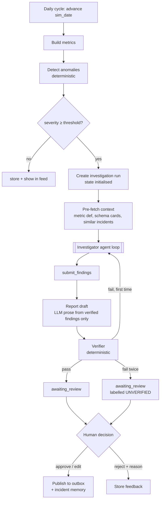

# Agent Workflow — MetricSentinel

> Status: Phase 0 planning document. No agent has been built.

## 1. Design decision: one agent

MetricSentinel uses **one LLM agent**, the **Investigator**. Everything else in the workflow is deterministic code or a single, non-agentic LLM call.

| Considered | Decision | Reason |
|---|---|---|
| Separate planner, SQL-analyst and critic agents | Rejected for MVP | They would share the same data and goal. Splitting them adds hand-offs, latency and failure modes, with no measured benefit. |
| Text-to-SQL as its own agent | **Made a tool** (`ask_data`) backed by a model call | It has a single, well-defined job (question → SQL → result) and does not need to choose among tools. Its model can still be swapped (hosted, local or fine-tuned). |
| LLM critic agent | **Replaced by a deterministic verifier** | Numbers can be checked exactly. An LLM re-reading its own prose has no ground truth. |
| Supervisor / group chat | Rejected | Hard to test, debug and budget |

**When a second agent would be justified** (re-assessed after Phase 5 measurements): if RCA traces show the Investigator's context filling up with SQL detail and hurting hypothesis quality, *or* if a fine-tuned SQL model needs its own multi-step repair loop, then `ask_data` can be promoted to a sub-agent with an isolated context. That change would need an evaluation showing an improvement in hit@3 or cost.

## 2. Workflow overview



| Step | Type |
|---|---|
| Advance day, build metrics, detect | Deterministic |
| Create run, pre-fetch context | Deterministic |
| Investigator loop | **Agent (LLM)** |
| `ask_data` SQL generation | LLM call inside a tool |
| Statistical tools | Deterministic |
| Report prose | Single LLM call, constrained |
| Verifier | Deterministic |
| Decision, publishing, memory write | Human-approved, deterministic execution |

## 3. The Investigator agent

| Property | Specification |
|---|---|
| Framework | Google ADK `LlmAgent` with function tools (LangGraph is the documented alternative) |
| Model | Planner role in `config/models.yaml`: hosted free-tier Gemini Flash-class model; local fallback via Ollama |
| Goal | Explain the anomaly with up to 3 ranked root-cause candidates, each backed by ledger evidence, or conclude "inconclusive" |
| Input | Anomaly record (metric, date, observed, expected, interval, q-value, flagged segments) + pre-fetched context |
| Output | `Findings` (Pydantic): `candidates[] {statement, dimension, segment, direction, contribution_share, confidence (high/medium/low), evidence_ledger_ids[]}`, `data_quality_suspected: bool`, `rejected_hypotheses[]`, `open_questions[]` |
| Budget | ≤ 12 tool calls, ≤ 60k tokens, ≤ 5 min wall time (FR-053) |
| Enforcement | ADK before-tool callbacks count steps and tokens; the runner stops the loop when a budget is hit |

### Reasoning procedure (encoded in the prompt, checked in evaluation)

1. **Rule out a data bug first** (`data_quality_check`).
2. Read the flagged segments from the detector.
3. Run `contribution_analysis` on each relevant dimension to find where the change is concentrated.
4. For the top segments, run `segment_test` to confirm significance and effect size.
5. Use `ask_data` for questions the fixed tools cannot answer (for example, "which sellers in SP drove the delay?").
6. Use `changepoint` if the onset date is unclear.
7. Stop when one candidate has high confidence with 2 or more independent pieces of evidence, or when the budget is reached.

## 4. Tools

All tools are read-only. Inputs and outputs are Pydantic models. Every tool result is written to the query ledger and returns a `ledger_id`.

| # | Tool | Input | Output | Implementation | Guardrails |
|---|---|---|---|---|---|
| 1 | `retrieve_context` | `query`, `corpus` (schema / metrics / incidents / examples), `k` | Chunks with source IDs | Hybrid retriever | k ≤ 8; incidents filtered to dates before `sim_date` |
| 2 | `ask_data` | `question` (natural language), `purpose` | `ledger_id`, SQL, row count, preview (≤ 20 rows, aggregated) | Text-to-SQL model → sqlglot guard → read-only DuckDB | Single SELECT; allow-listed views; `sim_date` views; 10 s timeout; 2 repairs max |
| 3 | `contribution_analysis` | `metric`, `dimension`, `anomaly_date`, `baseline_window` | Ranked segments with mix and rate effects | Python (pandas) over the metric store | Dimension must be in the catalogue |
| 4 | `segment_test` | `metric`, `dimension`, `segment`, windows | Effect size, p-value, n | SciPy | Minimum sample size, else "insufficient" |
| 5 | `changepoint` | `metric`, `dimension?`, `segment?`, `window` | Change-point dates | ruptures (PELT) | Window ≤ 120 days |
| 6 | `data_quality_check` | `date`, `tables[]` | Row-count deltas, duplicates, nulls vs trailing norms | SQL + Python | Fixed checks only |
| 7 | `submit_findings` | `Findings` | Ends the loop | Validation only | Every candidate must cite ≥ 1 existing ledger ID |

The agent has **no** tools to write data, call external URLs, send messages, or run arbitrary code.

## 5. State

One `InvestigationState` object per run. It is persisted to Postgres (`investigations.state`) after every tool call (NFR-007).

```text
InvestigationState
├── run_id, anomaly_id, sim_date, status
├── anomaly: {metric, date, observed, expected, lower, upper, q_value, segments[]}
├── context: [{chunk_id, source, text}]            # pre-fetched + retrieved
├── hypotheses: [{id, statement, status: open|supported|rejected|inconclusive, evidence_ids[]}]
├── ledger_ids: []                                  # rows live in LEDGER_ENTRIES
├── steps: [{n, tool, args, ledger_id?, error?, tokens, ms}]
├── findings: Findings | null
├── report: {version, markdown, verification[]}
├── budget: {steps_used, tokens_used, cost_usd, started_at}
└── versions: {prompt_ids, model_ids, data_hash, git_sha}
```

The agent sees a compact **view** of this state each turn (anomaly, hypotheses with status, recent step summaries). It does not see the full raw history, which keeps context small.

## 6. Memory

| Type | What | Where | Rule |
|---|---|---|---|
| Working memory | The run state above | Postgres | Lasts one run |
| Long-term (episodic) | **Approved** incident reports only | `INCIDENTS` + `RAG_CHUNKS` | Rejected or unverified reports are never stored as memory, so mistakes are not reinforced |
| Semantic | Metric catalogue, schema cards, SQL examples | `RAG_CHUNKS` | Versioned with the repository |
| Procedural | Prompts and tool specifications | `prompts/`, code | Versioned in git |

For evaluation runs, incident memory is **frozen or disabled**, so that scenario results are not contaminated by earlier answers to the same scenario.

## 7. Communication

There is no agent-to-agent messaging. Components communicate through:

- **Function calls** (the ADK runner calls tools),
- **The persisted state** (the workflow reads `findings` after the agent finishes),
- **Database records** (the API and UI read runs and reports).

## 8. Verification (deterministic)

1. Parse the draft report. Every number must be written in a machine-checkable form: `value [ledger:ID]`.
2. For each claim, look up the ledger value and compare it within a tolerance (rounding-aware, for example ±0.5% relative or the displayed precision).
3. Check direction words ("increased" / "decreased") against the sign of the evidence.
4. Check that segment names exist in the cited ledger result.
5. Output a `verification[]` list per claim. The report is `verified` only if all claims pass.
6. Optional `[EXT]`: a small LLM check for claims that are not numeric (for example, "concentrated in"), shown as advisory only.

## 9. Human-in-the-loop

| Point | Who | Options | Effect |
|---|---|---|---|
| Report review | `approver` | Approve / edit / reject (reason required) | Approve or edit → publish + incident memory; reject → feedback stored |
| Manual investigation trigger | `analyst` | Start a run for any anomaly | Same pipeline |
| Scenario and clock control | `admin` | Advance the day, load a scenario | Evaluation and demo control |

Edits by the approver are saved as a new report version. The diff between the agent draft and the approved version is stored, as future training data for report-writing preference tuning (`[FUTURE]`).

The agent never publishes. Publishing is executed by the approval service after the human decision (NFR-009, NFR-012).

## 10. Failure handling

| Failure | Handling |
|---|---|
| LLM error or timeout | Retry with backoff (max 3); then the fallback model; then the run becomes `failed` with its partial state kept |
| Invalid tool arguments | Pydantic error returned to the agent; counts as a step |
| SQL guard rejection | Reason returned to the agent (for example "table not allowed"); counts as a step |
| SQL execution error | Up to 2 automatic repairs inside `ask_data` |
| Same tool called with the same arguments twice | Return the cached result and a warning; a third repeat stops the run (loop detection) |
| Budget exhausted | Status `budget_exhausted`; findings forced from current hypotheses, marked low confidence |
| `submit_findings` cites a missing ledger ID | Rejected, the agent is asked to fix it (counts as a step) |
| Verifier fails twice | Report goes to review labelled **UNVERIFIED**, listing the failing claims |
| Prompt-injection text found in data | Tool output stays wrapped as untrusted; a detector logs it; security tests assert that no tool call follows the injected instruction (EXT) |
| Process restart | Runs left in `running` past the timeout become `failed` |

## 11. Agent evaluation

| Aspect | Metric |
|---|---|
| Outcome | Root-cause hit@1 / hit@3 against injected labels; correct data-bug identification rate |
| Trajectory | Whether `data_quality_check` was called first; redundant-call rate; guard rejections; steps to solution |
| Efficiency | Tokens, cost, wall time per run |
| Faithfulness | Verifier pass rate; human-audited sample |
| Robustness | Hit@3 with distractor faults; behaviour under injected review text (EXT) |

A small set of **reference trajectories** (about 10 scenarios, written by hand) is used as ADK evaluation cases for tool-order checks.
