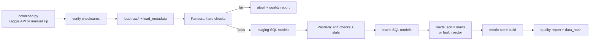

# Data Plan — MetricSentinel

> Status: Phase 2 in progress. The pipeline described here is implemented and tested on synthetic data.
> No real Olist data has been processed yet, so everything marked *confirm in EDA* is still an expectation.
> Section 14 records what was implemented and what is still pending.

## 1. Data sources

| Source | Use | Licence | Scope |
|---|---|---|---|
| **Brazilian E-Commerce Public Dataset by Olist** (Kaggle, `olistbr/brazilian-ecommerce`) | Main business data: about 100k orders, 2016–2018, 9 linked tables | CC BY-NC-SA 4.0 (non-commercial; suitable for a portfolio) | MVP |
| Brazilian public holidays (the `holidays` Python package) | Calendar features and forecast context | Open source | MVP |
| Generated: fault scenarios | Labelled anomalies for evaluation | Own | MVP |
| Generated: text-to-SQL question sets | SQL evaluation (and training, if fine-tuning goes ahead) | Own | MVP / EXT |
| Written: metric catalogue and schema docs | Retrieval corpus | Own | MVP |
| BIRD mini-dev (optional) | Extra, general SQL evaluation | Per dataset licence | OPT |

**Why Olist?** It has several linked tables (so joins are real), clear business KPIs, two years of daily history (so seasonality can be learned), several segment dimensions (state, category, payment type, seller), and free-text reviews in Portuguese. The reviews provide a realistic surface for indirect prompt injection.

## 2. Raw schema (as published)

| Table (file) | Grain | Key columns |
|---|---|---|
| `olist_orders_dataset` | 1 row per order | `order_id` (PK), `customer_id`, `order_status`, `order_purchase_timestamp`, `order_approved_at`, `order_delivered_carrier_date`, `order_delivered_customer_date`, `order_estimated_delivery_date` |
| `olist_order_items_dataset` | 1 row per item in an order | `order_id`, `order_item_id` (PK together), `product_id`, `seller_id`, `shipping_limit_date`, `price`, `freight_value` |
| `olist_order_payments_dataset` | 1 row per payment in an order | `order_id`, `payment_sequential`, `payment_type`, `payment_installments`, `payment_value` |
| `olist_order_reviews_dataset` | 1 row per review | `review_id`, `order_id`, `review_score`, `review_comment_title`, `review_comment_message`, `review_creation_date`, `review_answer_timestamp` |
| `olist_customers_dataset` | 1 row per customer-order ID | `customer_id` (PK), `customer_unique_id`, `customer_zip_code_prefix`, `customer_city`, `customer_state` |
| `olist_sellers_dataset` | 1 row per seller | `seller_id` (PK), `seller_zip_code_prefix`, `seller_city`, `seller_state` |
| `olist_products_dataset` | 1 row per product | `product_id` (PK), `product_category_name`, `product_name_lenght`, `product_description_lenght`, `product_photos_qty`, `product_weight_g`, `product_length_cm`, `product_height_cm`, `product_width_cm` |
| `olist_geolocation_dataset` | Many rows per zip prefix | `geolocation_zip_code_prefix`, `geolocation_lat`, `geolocation_lng`, `geolocation_city`, `geolocation_state` |
| `product_category_name_translation` | 1 row per category | `product_category_name`, `product_category_name_english` |

Note: the misspelling `lenght` is in the source. It is kept in `raw` and corrected in `staging`.

## 3. Expected data-quality issues (confirm in EDA)

| Expected issue | Planned handling |
|---|---|
| Very sparse orders at the start (late 2016) and a cut-off at the end (late 2018) | Restrict the monitoring window to dense months; use earlier months as warm-up history only |
| Delivered orders with a missing delivery date | Exclude from delivery KPIs; count in the quality report |
| `review_id` repeated across orders, or several reviews per order | Deduplicate by rule (latest review per order); log the counts |
| Orders with no items or no payments | Exclude from GMV and AOV; count in the quality report |
| Categories with no English translation, or a null category | Map to `unknown` |
| `payment_type = 'not_defined'` | Keep as its own value; exclude from segment testing if the sample is too small |
| Geolocation: many rows per zip prefix | Not used in MVP (state is the geographic dimension) |
| Review text in Portuguese, free-form, possibly containing personal names | Treat as untrusted; scrub PII before any hosted-LLM call |

## 4. Storage layout

One DuckDB file, `data/warehouse/warehouse.duckdb`, with schemas:

| Schema | Content | Written by | Read by |
|---|---|---|---|
| `raw` | Source tables as loaded, plus load metadata | Ingest | Staging models |
| `staging` | Typed, cleaned, renamed, pseudonymised | SQL runner | Marts |
| `marts` | Analysis-ready fact and dimension tables | SQL runner | Metric store, fault injector |
| `marts_scn` | Scenario copy of the marts (equal to `marts` in normal mode, faults injected in eval mode) | Fault injector | Metric store, agent tools |
| `metrics` | `daily_kpi`, `forecasts`, `anomaly_candidates` | Metric store, detector | Detector, API, agent tools |

Files on disk (none committed to git):

```
data/
├── raw/            # downloaded CSVs + checksums.json
├── warehouse/      # warehouse.duckdb
├── scenarios/      # scenario definitions (YAML, committed) + generated labels (JSON, not committed)
└── reports/        # data-quality reports (HTML/JSON)
```

Application state (runs, ledger, reports, audit, vectors) lives in PostgreSQL. See `SYSTEM_ARCHITECTURE.md` §8.

## 5. Modelled tables (marts)

| Table | Grain | Main columns (planned) |
|---|---|---|
| `fct_orders` | Order | order_id, customer_key, purchase_date, approved_at, delivered_date, estimated_date, status, is_delivered, is_late, delivery_days, item_count, order_gmv, freight_total |
| `fct_order_items` | Order item | order_id, item_seq, product_id, seller_id, category_en, price, freight |
| `fct_payments` | Payment | order_id, seq, payment_type, installments, value |
| `fct_reviews` | Review (deduplicated to 1 per order) | order_id, review_date, score, has_comment, comment_text (untrusted) |
| `dim_customers` | Customer | customer_key (pseudonymised), state, city |
| `dim_sellers` | Seller | seller_id, state, city |
| `dim_products` | Product | product_id, category_en, weight_g, volume_cm3 |
| `dim_date` | Day | date, weekday, week, month, is_holiday_br |

**Seller tier** is computed *point-in-time*: quartile of trailing-90-day GMV as of each date. This prevents future information from leaking into the past.

## 6. Metric catalogue (MVP)

8 KPIs × 4 dimensions. Each KPI is also monitored as a single total series.

| KPI | Definition | Event date used | "Bad" direction | Min. sample per day |
|---|---|---|---|---|
| `orders` | count of distinct orders | purchase date | down | — |
| `gmv` | sum of item price | purchase date | down | — |
| `aov` | gmv / orders | purchase date | down | 30 orders |
| `freight_ratio` | sum freight / sum price | purchase date | up | 30 orders |
| `late_delivery_rate` | late delivered / delivered | delivered date | up | 30 deliveries |
| `avg_delivery_days` | mean(delivered − purchase), in days | delivered date | up | 30 deliveries |
| `avg_review_score` | mean review score | review date | down | 30 reviews |
| `low_review_rate` | share of scores ≤ 2 | review date | up | 30 reviews |

| Dimension | Source | Expected cardinality (confirm in EDA) |
|---|---|---|
| `customer_state` | dim_customers | 27 |
| `category_en` | dim_products via items | about 70 |
| `payment_type` | fct_payments (primary payment) | 5 |
| `seller_tier` | point-in-time quartile | 4 |

The catalogue is stored as `config/metrics.yaml` (planned). It is also indexed for retrieval, so that the agent reads the *official* definition instead of guessing it.

Series with too little daily volume are aggregated to weekly granularity or excluded. The exact rule is decided in Phase 3 from EDA.

## 7. Ingestion and processing pipeline



- **Idempotent:** re-running with the same inputs produces an identical `data_hash`.
- **One command:** `make data` (planned) runs the whole flow.
- **`data_hash`** = SHA-256 of (raw file checksums + git SHA of the SQL models + metric catalogue). It is stored with every detection run, eval run and report.

## 8. Validation rules (examples)

| Level | Rule |
|---|---|
| Hard | Primary keys unique; `order_id` in items and payments exists in orders; `price ≥ 0`; `review_score ∈ {1..5}`; timestamps parse |
| Hard | Row count of each raw table is within ±1% of the expected count recorded at first load |
| Soft | Null rate of delivery dates for delivered orders is below the threshold set in EDA |
| Soft | Share of `unknown` category is below the threshold set in EDA |
| Soft | Daily order counts have no gaps inside the monitoring window |

## 9. Historical vs "real-time" data

Olist is a static historical dataset. MetricSentinel will not pretend otherwise. It uses a **simulated clock**:

- The system has a current `sim_date`. Detection, forecasts and all agent SQL see only events with an event date ≤ `sim_date`. The SQL guard enforces this by injecting a date filter through a view layer parameterised by `sim_date`.
- `POST /admin/sim/advance` moves the clock one day and runs the daily cycle. This replays history as if data arrived daily.
- **Warm-up:** at least 90 days of history before the first detection date (exact start confirmed in EDA).
- **Real-time streaming is out of scope.** A live-connector design is listed as `[FUTURE]`.

## 10. Fault injection (evaluation data)

Faults are applied to `marts_scn`, never to `raw` or `marts`. Each fault writes a label that the agent cannot see.

| Fault type | Mechanism | Primary KPI affected | Label (ground truth) |
|---|---|---|---|
| `segment_level_shift` | Remove or duplicate a share of orders in one state or category from date D | orders, gmv | dimension = value |
| `seller_delay` | Add N days to the delivery dates of a seller group in one state | late_delivery_rate, avg_delivery_days | seller group + state |
| `payment_failure` | Cancel a share of orders with one payment type | orders, gmv | payment_type = value |
| `category_price_change` | Multiply prices in one category by a factor | aov, gmv | category = value |
| `review_collapse` | Lower review scores for orders from one seller group or category | avg_review_score, low_review_rate | dimension = value |
| `pipeline_bug` | Duplicate or drop rows for one day or one table | orders, gmv (spike or drop) | data_quality: table + date |

Parameters: start date, duration, magnitude (for example 10–60%), and affected share. Scenario definitions are committed as YAML. Generation is seeded, so it is reproducible.

Benchmark sizes: 30 scenarios (MVP), 100 scenarios (EXT). Each set is stratified across fault types and magnitudes, and a few "no fault" days are included to measure false alarms.

## 11. Data for text-to-SQL

| Set | Size | Source | Use |
|---|---|---|---|
| SQL test set | 100 (MVP) → 150 (EXT) | Written by hand; each verified by execution | Evaluation only; never used for training |
| Retrieval gold labels | Same questions, plus gold tables and definitions | Written by hand | Retrieval evaluation |
| Synthetic training set | 3k–5k | Teacher model from templates, filtered by execution and deduplication | Only if fine-tuning goes ahead (Phase 8) |

Splits are made **by template family**, so paraphrases of a test question cannot appear in training. See `AI_ML_PLAN.md` §6.

## 12. Privacy and data protection

- The source data is already anonymised by the publisher. Some additional protections are still applied, as good practice and as a skill demonstration:
  - `customer_unique_id` and `customer_id` are replaced by salted hashes in `staging`. The salt comes from an environment variable.
  - Zip-code prefixes are not exposed to agent tools.
  - Review comment text is truncated, and passed through a PII scrubber (names, emails, phone numbers) before it can reach any hosted LLM.
  - Hosted LLMs receive schema, aggregated results and scrubbed previews only (NFR-014). Row-level exports are not possible through agent tools (row limit plus aggregation-first prompts).
- Raw data is never committed to git (`.gitignore`).
- Licence compliance: the source is attributed in the README; use is non-commercial.

## 13. Data versioning

| Artefact | How it is versioned |
|---|---|
| Raw files | `checksums.json` (committed) |
| Pipeline logic | Git |
| Warehouse build | `data_hash` |
| Scenario definitions | Git (YAML) |
| Eval question sets | Git (small JSONL files) |
| Synthetic training data (EXT) | DVC or Hugging Face dataset repo — decided in Phase 8 |

## 14. Phase 2 implementation notes and EDA status

### Implemented (verified on synthetic data only)

| Item | Where |
|---|---|
| Download from a manual zip or the Kaggle API; credentials are not forwarded to the redirect target | `pipelines/download.py` |
| `raw` layer: every CSV loaded as text, unchanged, plus `raw._load_metadata` | `pipelines/build.py` |
| Hard checks (Pandera schemas, foreign keys, published row counts +/-1%) stop the build before any model runs | `pipelines/validate.py` |
| `staging` and `marts` SQL models, run in filename order | `pipelines/sql_models/` |
| Soft checks, statistics, mart integrity checks, `data_hash`, `warehouse_content_hash`, HTML and JSON report | `pipelines/quality.py` |
| EDA: monitoring window, seasonality, KPI distributions, segment sizes, sample-size rule, expected-issue verdicts | `pipelines/eda.py`, `notebooks/01_eda.ipynb` |

### Decisions made while implementing

- **Atomic build.** The warehouse is built in a temporary file and replaces the real one only if every hard check passes.
- **Money is `DECIMAL(12,2)`**, so sums are exact and the content hash does not depend on summation order.
- **Pseudonymisation.** `customer_id` becomes `customer_ref` and `customer_unique_id` becomes `customer_key`, both salted SHA-256 (first 32 hex characters). Zip prefixes are dropped in staging. The salt comes from `PSEUDONYM_SALT`; the default is public and for development only.
- **Customer state.** `fct_orders.customer_state` is the state at the time of the order. `dim_customers` holds the latest known state per person. Use the order-level column for analysis.
- **`is_delivered`** is `status = 'delivered'` and a delivery timestamp exists. **`is_late`** compares calendar dates (delivered date later than estimated date).
- **Primary payment** is the payment with the largest value (ties: lowest sequence number).
- **Seller tier** (`marts.seller_tier_daily`) uses only the 90 days *before* each day, so a day cannot influence its own tier. Tiers are `T1`..`T4` (T4 = top quartile of GMV among sellers with GMV in the window) or `unrated`. This adds a fifth value to a dimension the plan expected to have four; Phase 3 must decide whether to monitor `unrated`.
- **`data_hash`** covers raw file checksums, a hash of the SQL model files' contents, the metric catalogue (once `config/metrics.yaml` exists), the `holidays` package version and a fingerprint of the salt. `warehouse_content_hash` additionally hashes the rows of every mart, and proves a rebuild is identical. Windows and Linux produce the same values for the same input.
- **Soft checks run after the marts are built**, not between staging and marts as the diagram shows, because two of them need mart tables. They never stop the build.

### Real-data results (first run, 2026-10-22; `data_hash` 97f3df47619c210e00643e5ab90d66ae22a0ffe3d0a568403a6d029263da58e3)

The Kaggle dataset was downloaded and `make data` + `make eda` were run on it. Every hard check passed (38 of 38).
A second build produced the same `data_hash` and `warehouse_content_hash`. The published row counts used in
`pipelines/config.py` matched the files exactly, and the real reviews file (multi-line comments) parsed correctly.

**Warehouse sizes:** 99,441 orders, 112,650 items, 103,886 payments, 98,673 reviews (after keeping one per order),
96,096 distinct customers, 3,095 sellers, 32,951 products.

**Monitoring window (derived, not assumed).** Dense day = 7-day mean at least max(20, 0.25 x median daily orders)
(floor 37 orders; median day 148 orders). Longest run: **2017-01-26 to 2018-08-31** (583 days). Warm-up starts
2017-01-26; the first detection date is **2017-04-26** (90 warm-up days); **493 days** are monitored. 51 days with
orders fall outside the window (the sparse start and the end of the data).

**Expected issues in section 3: all nine confirmed.**

| Issue | Observed |
|---|---|
| Sparse start and cut-off | 51 days with orders outside the dense window |
| Delivered, no delivery date | 8 orders (0.0083% of 96,478 delivered) |
| Several reviews per order | 547 orders; 99,224 review rows reduced to 98,673 |
| `review_id` reused across orders | 789 review ids |
| Orders with no items | 775 (0.78%) |
| Orders with no payment | 1 |
| Unknown category | 610 products with no category + 13 with no translation = 623 products; 1.44% of items |
| `payment_type = not_defined` | 3 payment rows |
| Geolocation many rows per zip | 1,000,163 rows for 19,015 prefixes |

**Seasonality (inside the window).** Weekday effect is strong: Monday 1.15, Tuesday 1.13, Wednesday 1.10, Saturday 0.77,
Sunday 0.85 (1.0 = average day); busiest/quietest ratio 1.49. Brazilian public holidays have 0.75x the orders of a
normal day. **Black Friday 2017 (2017-11-24) had 6.4x the orders of the previous three weeks' average**, so the
forecasting model must know about it or the detector will raise a false alarm on that day and on the days after it.

**Daily KPI behaviour (inside the window).**

| KPI | mean | coefficient of variation | days with n >= 30 |
|---|---|---|---|
| orders | 169 | 0.52 | n/a |
| gmv | 23,200 | 0.52 | n/a |
| aov | 139 | 0.18 | 99% |
| freight_ratio | 0.166 | 0.15 | 99% |
| late_delivery_rate | 6.8% | 1.27 | 80% |
| avg_delivery_days | 12.8 | 0.29 | 80% |
| avg_review_score | 4.06 | 0.10 | 82% |
| low_review_rate | 15.3% | 0.71 | 82% |

`late_delivery_rate` and `low_review_rate` are very noisy day to day (coefficient of variation above 0.7), so a
plain interval test on them will be sensitive to noise; Phase 3 should treat them as rates with a binomial model
or smooth them.

**Dimensions.** `customer_state` 27 values, `category_en` 72, `payment_type` 5 (as expected). `seller_tier` has 5 values
because of `unrated` (see the seller-tier decision above).

**Minimum-sample rule, with evidence.** Rule: a series is monitored daily if at least 80% of window days have n >= 30,
weekly if at least 80% of weeks do, otherwise excluded.

| dimension | values | daily | weekly | excluded (orders as the sample) |
|---|---|---|---|---|
| customer_state | 27 | 1 | 4 | 22 |
| category_en | 72 | 0 | 6 | 66 |
| payment_type | 5 | 1 | 1 | 3 |
| seller_tier | 5 | 1 | 4 | 0 |

The same pattern holds when deliveries or reviews are the sample (see `data/reports/eda_findings.md`).
**This is the most important finding for Phase 3:** the plan assumed about 8 KPIs x 4 dimensions of segment series,
but with a 30-per-day sample rule almost all state and category segments are too small to monitor daily. Only the
total series and three segments qualify for daily monitoring: state `SP` (87% of days), payment type `credit_card`
(98%) and seller tier `T4` (95%). Even the largest category (`bed_bath_table`) averages only 16 orders a day. Note the table above applies the 30-sample rule to order counts too, although the plan sets no minimum
for `orders` and `gmv`. Phase 3 has to choose between weekly granularity for small segments, pooling small segments,
or a lower sample rule for count KPIs; this is recorded as an open decision, not decided here.

**Thresholds set from this run** (`pipelines/config.py`): delivered-without-date soft limit 0.1% (observed 0.0083%),
unknown-category soft limit 2.5% (observed 1.44%), and the "no gaps" check now uses the window above (0 gap days).

### Still open

1. The notebook `notebooks/01_eda.ipynb` has no stored outputs (no Jupyter dependency was added). All numbers above come from `pipelines/eda.py`; run `make eda` to regenerate `data/reports/eda_findings.md`.
2. Open design decision for Phase 3: how to monitor small segments (see the minimum-sample finding).

### Phase 3 additions (2026-10-23)

* **Small segments (open decision from Phase 2, now implemented).** `metrics.series_plan` classifies every
  KPI x segment on clean data: daily if at least 80% of days meet the KPI's minimum sample, else weekly if at
  least 80% of weeks do, else pooled into one `__other__` series per dimension. Result: 32 daily and 182 weekly
  series are monitored. The volume KPIs use a minimum sample of 10 (the plan had none), so MG, RJ, boleto and
  tier T3 also qualify daily for `orders` and `gmv`.
* **One dimension value per order.** Category and seller tier are taken from the order's most expensive item,
  so segments add up exactly to the total (a hard check in `make data`).
* **Simulated clock limitation.** `sim.*` views hide future deliveries, approvals and reviews, but the order
  status is the final snapshot: a cancellation after the simulated date cannot be undone.
* **Data cut-off.** The data ends abruptly (orders fall to 1-14 a day on 29-31 August 2018). The Phase 2 window
  rule (trailing 7-day mean) did not exclude these days; see AI_ML_PLAN.md section 2.5.

### Last reliable day (Phase 3b) - validity rule defined after diagnosis

The Olist data does not end cleanly. In the Phase 3 evaluation, orders fell to 14, 4 and 1 on the last three days of August 2018, and the Phase 2 window rule (a trailing 7-day mean) let those days into the monitoring window.

**The rule (fixed 2026-10-26, before any 3b result existed, and not to be tuned):**

1. A day is a **collapse day** if its total orders are below **35%** of the **median of the total orders of the previous 28 days**.
2. The **last reliable day** is the day before the **terminal run** of consecutive collapse days that ends at the last day of the data. If the data does not end in a collapse, it is the last day of the data.
3. Days after the last reliable day are **not tested** and raise **no alert**; they are logged as suppressed, and are not counted as clean tested days.
4. Separately, on any collapse day the guard raises one alert, "volume collapse (data feed or business)", and suppresses every other test that day.

**Value, computed by `ds/feed_guard.py` on the real warehouse (data_hash 97f3df47...): 2018-08-24.** The collapse days after it are 25, 26, 27, 28, 29, 30 and 31 August 2018. The date is stored in `config/detection.yaml` (`feed_guard.data_end`), and `python -m ds.feed_guard --check` recomputes it from the warehouse and fails if the two differ.

**Label: validity rule defined after diagnosis.** It was written after the end-of-data drop had been seen in the Phase 3 evaluation. It uses the future of the series (the terminal run), so it applies to a finished dataset and cannot be applied causally day by day; the per-day collapse rule (point 4) can.

**Side finding (recorded before the 2017 evaluation).** The same collapse rule also fires on 2017-06-21 (fit period) and on **2017-12-24**, a legitimate holiday day (59 orders, 27% of the norm). It does not fire on 25 December (41%). No exemption was added.

### Phase 2 window rule corrected (Phase 3b)

The monitoring-window rule used a trailing 7-day mean, which lags. It now uses a **centred** 7-day mean (the first and last three days have no full window and are not dense). Same floor (37 orders), same longest-run rule.

| | Before (trailing) | After (centred) |
|---|---|---|
| Dense window | 2017-01-26 to 2018-08-31 | 2017-01-23 to 2018-08-28 |
| Warm-up start | 2017-01-26 | 2017-01-23 |
| First detection date | 2017-04-26 | 2017-04-23 |
| Monitored days | 493 | 493 |

The correction moves **both** ends three days earlier. It does **not** remove the first collapse days: 25 to 28 August are still inside the corrected window, which is why the last reliable day is defined by the collapse rule above and not by the window rule.

**`config/detection.yaml` keeps `monitoring_window` 2017-01-26 to 2018-08-31.** Changing it would move the metric-store dates and the series plan and so change the Phase 3 baseline, which must stay reproducible (the golden tests reproduce it exactly). The corrected window is documented here and used by the EDA only.

The figures in section 14 above were computed on the old window. Recomputed on the corrected window, these figures moved by more than 0.5% (everything not listed moved less):

| Figure | Old window | Corrected window |
|---|---|---|
| Dense window start | 2017-01-26 | 2017-01-23 |
| Dense window end | 2018-08-31 | 2018-08-28 |
| Warm-up start | 2017-01-26 | 2017-01-23 |
| First detection date | 2017-04-26 | 2017-04-23 |
| Weekday index, Friday | 0.987 | 0.998 |
| Weekday index, Monday | 1.145 | 1.133 |
| Weekday index, Thursday | 1.03 | 1.04 |
| Weekday index, Tuesday | 1.127 | 1.115 |
| orders, coefficient_of_variation | 0.5199 | 0.5173 |
| aov, share_of_days_with_sample_ge_30 | 0.9931 | 0.9983 |
| freight_ratio, share_of_days_with_sample_ge_30 | 0.9931 | 0.9983 |
| late_delivery_rate, mean | 0.06797 | 0.06723 |
| late_delivery_rate, std | 0.08634 | 0.08574 |
| avg_review_score, share_of_days_with_sample_ge_30 | 0.8216 | 0.8165 |
| low_review_rate, share_of_days_with_sample_ge_30 | 0.8216 | 0.8165 |
| customer_state, reviews, weekly series | 5 | 4 |
| customer_state, reviews, excluded series | 22 | 23 |

These values are copied from `data/reports/eda_findings.json` by a script, not typed by hand.
