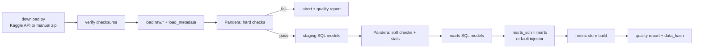

# Data Plan — MetricSentinel

> Status: Phase 0 planning document. No data has been downloaded or processed yet.
> Items marked *confirm in EDA* are expectations that Phase 2 must verify.

## 1. Data sources

| Source | Use | Licence | Scope |
|---|---|---|---|
| **Brazilian E-Commerce Public Dataset by Olist** (Kaggle, `olistbr/brazilian-ecommerce`) | Main business data: about 100k orders, 2016–2018, 9 linked tables | CC BY-NC-SA 4.0 (non-commercial; suitable for a portfolio) | MVP |
| Brazilian public holidays (the `holidays` Python package) | Calendar features and forecast context | Open source | MVP |
| Generated: fault scenarios | Labelled anomalies for evaluation | Own | MVP |
| Generated: text-to-SQL question sets | SQL evaluation (and training, if fine-tuning goes ahead) | Own | MVP / EXT |
| Written: metric catalogue and schema docs | Retrieval corpus | Own | MVP |
| BIRD mini-dev (optional) | Extra, general SQL evaluation | Per dataset licence | OPT |

**Why Olist?** It has several linked tables (so joins are real), clear business KPIs, two years of daily history (so seasonality can be learned), several segment dimensions (state, category, payment type, seller), and free-text reviews in Portuguese. The reviews provide a realistic surface for indirect prompt injection.

## 2. Raw schema (as published)

| Table (file) | Grain | Key columns |
|---|---|---|
| `olist_orders_dataset` | 1 row per order | `order_id` (PK), `customer_id`, `order_status`, `order_purchase_timestamp`, `order_approved_at`, `order_delivered_carrier_date`, `order_delivered_customer_date`, `order_estimated_delivery_date` |
| `olist_order_items_dataset` | 1 row per item in an order | `order_id`, `order_item_id` (PK together), `product_id`, `seller_id`, `shipping_limit_date`, `price`, `freight_value` |
| `olist_order_payments_dataset` | 1 row per payment in an order | `order_id`, `payment_sequential`, `payment_type`, `payment_installments`, `payment_value` |
| `olist_order_reviews_dataset` | 1 row per review | `review_id`, `order_id`, `review_score`, `review_comment_title`, `review_comment_message`, `review_creation_date`, `review_answer_timestamp` |
| `olist_customers_dataset` | 1 row per customer-order ID | `customer_id` (PK), `customer_unique_id`, `customer_zip_code_prefix`, `customer_city`, `customer_state` |
| `olist_sellers_dataset` | 1 row per seller | `seller_id` (PK), `seller_zip_code_prefix`, `seller_city`, `seller_state` |
| `olist_products_dataset` | 1 row per product | `product_id` (PK), `product_category_name`, `product_name_lenght`, `product_description_lenght`, `product_photos_qty`, `product_weight_g`, `product_length_cm`, `product_height_cm`, `product_width_cm` |
| `olist_geolocation_dataset` | Many rows per zip prefix | `geolocation_zip_code_prefix`, `geolocation_lat`, `geolocation_lng`, `geolocation_city`, `geolocation_state` |
| `product_category_name_translation` | 1 row per category | `product_category_name`, `product_category_name_english` |

Note: the misspelling `lenght` is in the source. It is kept in `raw` and corrected in `staging`.

## 3. Expected data-quality issues (confirm in EDA)

| Expected issue | Planned handling |
|---|---|
| Very sparse orders at the start (late 2016) and a cut-off at the end (late 2018) | Restrict the monitoring window to dense months; use earlier months as warm-up history only |
| Delivered orders with a missing delivery date | Exclude from delivery KPIs; count in the quality report |
| `review_id` repeated across orders, or several reviews per order | Deduplicate by rule (latest review per order); log the counts |
| Orders with no items or no payments | Exclude from GMV and AOV; count in the quality report |
| Categories with no English translation, or a null category | Map to `unknown` |
| `payment_type = 'not_defined'` | Keep as its own value; exclude from segment testing if the sample is too small |
| Geolocation: many rows per zip prefix | Not used in MVP (state is the geographic dimension) |
| Review text in Portuguese, free-form, possibly containing personal names | Treat as untrusted; scrub PII before any hosted-LLM call |

## 4. Storage layout

One DuckDB file, `data/warehouse/warehouse.duckdb`, with schemas:

| Schema | Content | Written by | Read by |
|---|---|---|---|
| `raw` | Source tables as loaded, plus load metadata | Ingest | Staging models |
| `staging` | Typed, cleaned, renamed, pseudonymised | SQL runner | Marts |
| `marts` | Analysis-ready fact and dimension tables | SQL runner | Metric store, fault injector |
| `marts_scn` | Scenario copy of the marts (equal to `marts` in normal mode, faults injected in eval mode) | Fault injector | Metric store, agent tools |
| `metrics` | `daily_kpi`, `forecasts`, `anomaly_candidates` | Metric store, detector | Detector, API, agent tools |

Files on disk (none committed to git):

```
data/
├── raw/            # downloaded CSVs + checksums.json
├── warehouse/      # warehouse.duckdb
├── scenarios/      # scenario definitions (YAML, committed) + generated labels (JSON, not committed)
└── reports/        # data-quality reports (HTML/JSON)
```

Application state (runs, ledger, reports, audit, vectors) lives in PostgreSQL. See `SYSTEM_ARCHITECTURE.md` §8.

## 5. Modelled tables (marts)

| Table | Grain | Main columns (planned) |
|---|---|---|
| `fct_orders` | Order | order_id, customer_key, purchase_date, approved_at, delivered_date, estimated_date, status, is_delivered, is_late, delivery_days, item_count, order_gmv, freight_total |
| `fct_order_items` | Order item | order_id, item_seq, product_id, seller_id, category_en, price, freight |
| `fct_payments` | Payment | order_id, seq, payment_type, installments, value |
| `fct_reviews` | Review (deduplicated to 1 per order) | order_id, review_date, score, has_comment, comment_text (untrusted) |
| `dim_customers` | Customer | customer_key (pseudonymised), state, city |
| `dim_sellers` | Seller | seller_id, state, city |
| `dim_products` | Product | product_id, category_en, weight_g, volume_cm3 |
| `dim_date` | Day | date, weekday, week, month, is_holiday_br |

**Seller tier** is computed *point-in-time*: quartile of trailing-90-day GMV as of each date. This prevents future information from leaking into the past.

## 6. Metric catalogue (MVP)

8 KPIs × 4 dimensions. Each KPI is also monitored as a single total series.

| KPI | Definition | Event date used | "Bad" direction | Min. sample per day |
|---|---|---|---|---|
| `orders` | count of distinct orders | purchase date | down | — |
| `gmv` | sum of item price | purchase date | down | — |
| `aov` | gmv / orders | purchase date | down | 30 orders |
| `freight_ratio` | sum freight / sum price | purchase date | up | 30 orders |
| `late_delivery_rate` | late delivered / delivered | delivered date | up | 30 deliveries |
| `avg_delivery_days` | mean(delivered − purchase), in days | delivered date | up | 30 deliveries |
| `avg_review_score` | mean review score | review date | down | 30 reviews |
| `low_review_rate` | share of scores ≤ 2 | review date | up | 30 reviews |

| Dimension | Source | Expected cardinality (confirm in EDA) |
|---|---|---|
| `customer_state` | dim_customers | 27 |
| `category_en` | dim_products via items | about 70 |
| `payment_type` | fct_payments (primary payment) | 5 |
| `seller_tier` | point-in-time quartile | 4 |

The catalogue is stored as `config/metrics.yaml` (planned). It is also indexed for retrieval, so that the agent reads the *official* definition instead of guessing it.

Series with too little daily volume are aggregated to weekly granularity or excluded. The exact rule is decided in Phase 3 from EDA.

## 7. Ingestion and processing pipeline



- **Idempotent:** re-running with the same inputs produces an identical `data_hash`.
- **One command:** `make data` (planned) runs the whole flow.
- **`data_hash`** = SHA-256 of (raw file checksums + git SHA of the SQL models + metric catalogue). It is stored with every detection run, eval run and report.

## 8. Validation rules (examples)

| Level | Rule |
|---|---|
| Hard | Primary keys unique; `order_id` in items and payments exists in orders; `price ≥ 0`; `review_score ∈ {1..5}`; timestamps parse |
| Hard | Row count of each raw table is within ±1% of the expected count recorded at first load |
| Soft | Null rate of delivery dates for delivered orders is below the threshold set in EDA |
| Soft | Share of `unknown` category is below the threshold set in EDA |
| Soft | Daily order counts have no gaps inside the monitoring window |

## 9. Historical vs "real-time" data

Olist is a static historical dataset. MetricSentinel will not pretend otherwise. It uses a **simulated clock**:

- The system has a current `sim_date`. Detection, forecasts and all agent SQL see only events with an event date ≤ `sim_date`. The SQL guard enforces this by injecting a date filter through a view layer parameterised by `sim_date`.
- `POST /admin/sim/advance` moves the clock one day and runs the daily cycle. This replays history as if data arrived daily.
- **Warm-up:** at least 90 days of history before the first detection date (exact start confirmed in EDA).
- **Real-time streaming is out of scope.** A live-connector design is listed as `[FUTURE]`.

## 10. Fault injection (evaluation data)

Faults are applied to `marts_scn`, never to `raw` or `marts`. Each fault writes a label that the agent cannot see.

| Fault type | Mechanism | Primary KPI affected | Label (ground truth) |
|---|---|---|---|
| `segment_level_shift` | Remove or duplicate a share of orders in one state or category from date D | orders, gmv | dimension = value |
| `seller_delay` | Add N days to the delivery dates of a seller group in one state | late_delivery_rate, avg_delivery_days | seller group + state |
| `payment_failure` | Cancel a share of orders with one payment type | orders, gmv | payment_type = value |
| `category_price_change` | Multiply prices in one category by a factor | aov, gmv | category = value |
| `review_collapse` | Lower review scores for orders from one seller group or category | avg_review_score, low_review_rate | dimension = value |
| `pipeline_bug` | Duplicate or drop rows for one day or one table | orders, gmv (spike or drop) | data_quality: table + date |

Parameters: start date, duration, magnitude (for example 10–60%), and affected share. Scenario definitions are committed as YAML. Generation is seeded, so it is reproducible.

Benchmark sizes: 30 scenarios (MVP), 100 scenarios (EXT). Each set is stratified across fault types and magnitudes, and a few "no fault" days are included to measure false alarms.

## 11. Data for text-to-SQL

| Set | Size | Source | Use |
|---|---|---|---|
| SQL test set | 100 (MVP) → 150 (EXT) | Written by hand; each verified by execution | Evaluation only; never used for training |
| Retrieval gold labels | Same questions, plus gold tables and definitions | Written by hand | Retrieval evaluation |
| Synthetic training set | 3k–5k | Teacher model from templates, filtered by execution and deduplication | Only if fine-tuning goes ahead (Phase 8) |

Splits are made **by template family**, so paraphrases of a test question cannot appear in training. See `AI_ML_PLAN.md` §6.

## 12. Privacy and data protection

- The source data is already anonymised by the publisher. Some additional protections are still applied, as good practice and as a skill demonstration:
  - `customer_unique_id` and `customer_id` are replaced by salted hashes in `staging`. The salt comes from an environment variable.
  - Zip-code prefixes are not exposed to agent tools.
  - Review comment text is truncated, and passed through a PII scrubber (names, emails, phone numbers) before it can reach any hosted LLM.
  - Hosted LLMs receive schema, aggregated results and scrubbed previews only (NFR-014). Row-level exports are not possible through agent tools (row limit plus aggregation-first prompts).
- Raw data is never committed to git (`.gitignore`).
- Licence compliance: the source is attributed in the README; use is non-commercial.

## 13. Data versioning

| Artefact | How it is versioned |
|---|---|
| Raw files | `checksums.json` (committed) |
| Pipeline logic | Git |
| Warehouse build | `data_hash` |
| Scenario definitions | Git (YAML) |
| Eval question sets | Git (small JSONL files) |
| Synthetic training data (EXT) | DVC or Hugging Face dataset repo — decided in Phase 8 |
