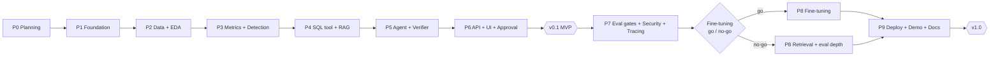

# Roadmap — MetricSentinel

> Current phase: **Phase 2 — Data Ingestion, Validation & EDA** (code complete and tested on synthetic data; the first run on the real dataset and the real EDA findings are still outstanding).
> Phases 0 and 1 are complete (Phase 1 CI is green on `main`). No MetricSentinel feature has been verified on real data yet.
> Durations are part-time estimates, not commitments.

## Overview



| Phase | Name | Est. duration | Cumulative | Milestone |
|---|---|---|---|---|
| 0 | Planning & initialization | 1 week | 1 | Plan approved |
| 1 | Repository foundation & dev environment | 1 week | 2 | Empty skeleton runs in Docker |
| 2 | Data ingestion, validation & EDA | 2 weeks | 4 | Reproducible warehouse |
| 3 | Metric store, forecasting & anomaly detection | 3 weeks | 7 | Detection measured |
| 4 | Guarded SQL tool, RAG & text-to-SQL baselines | 2 weeks | 9 | SQL + retrieval measured |
| 5 | Investigation agent, verifier & reports | 3 weeks | 12 | RCA measured |
| 6 | Backend, approval workflow, scheduler & UI | 2 weeks | 14 | **v0.1 MVP** |
| 7 | Evaluation gates, security hardening & observability | 2 weeks | 16 | Security gate passed |
| 8 | Fine-tuning (gated) *or* retrieval/eval depth | 3 weeks | 19 | Decision documented |
| 9 | Deployment, demo & documentation | 2 weeks | 21 | **v1.0** |

---

## Phase 0 — Planning & Initialization *(complete)*

**Objective:** Agree on what will be built, why, and how success is measured, before writing code.

**Tasks**
- Write the vision, requirements, scope, tech stack, architecture, data, AI/ML, agent and roadmap documents.
- Choose the dataset and check its licence.
- Define the status labels (`[MVP]`, `[EXT]`, `[FUTURE]`, `[DONE]`) and use them consistently.
- List open decisions for owner approval.

**Deliverables:** `README.md`, `docs/*.md` (9 files), `.gitignore`.

**Dependencies:** none.

**Acceptance criteria**
- Every FR and NFR has an ID, a priority, a scope label and a phase.
- Every technology in `TECH_STACK.md` has a reason and at least one alternative.
- The documents do not contradict each other (numbers, names, phases, tools).
- Nothing is described as implemented.

**Definition of Done:** the owner has reviewed and approved the documents and the open decisions (see the end of this file). The repository is initialised with these files as the first commit.

---

## Phase 1 — Repository Foundation & Dev Environment *(complete)*

**Objective:** A clean, reproducible project skeleton, so that every later phase adds features rather than setup.

**Tasks**
- Create the directory layout (see "Planned repository layout" below).
- Set up `pyproject.toml` with uv; pin versions; configure ruff, mypy (lenient), pytest and pre-commit.
- Create `docker-compose.yml` with `postgres` (pgvector) and placeholder `api` and `ui` services.
- Add configuration loading (Pydantic Settings) and `.env.example`.
- Add structured logging (structlog) with `run_id` support.
- Add a Makefile with targets `setup`, `lint`, `test`, `data`, `eval`, `up`.
- Add the MLflow local tracking setup.
- Create a basic GitHub Actions workflow for lint and unit tests only.

**Deliverables:** runnable skeleton; `/health` endpoint returning OK; passing CI on an empty test suite.

**Dependencies:** Phase 0 approved.

**Acceptance criteria**
- `make setup && make lint && make test` passes on a clean machine.
- `docker compose up` starts Postgres and the API; `/health` returns 200.
- No secrets in the repository; `.env.example` documents every variable.

**Definition of Done:** CI is green on `main`; the README "Getting started" section is updated; the ROADMAP status is updated.

---

## Phase 2 — Data Ingestion, Validation & EDA *(current)*

**Status:** pipeline, tests and EDA tooling are built and pass on synthetic data. **Outstanding before this phase can be closed:** (1) run `make data` on the real Olist data and commit `data/raw/checksums.json`; (2) run `make eda` / execute `notebooks/01_eda.ipynb` and record the confirmed facts in `docs/DATA_PLAN.md` section 14; (3) review the soft-check thresholds that are marked PROVISIONAL.

**Objective:** A reproducible warehouse built from Olist, with known data quality and an EDA that informs the detection design.

**Tasks**
- Downloader with checksums (FR-001).
- Load the `raw` schema (FR-002); Pandera hard and soft checks (FR-003).
- Staging models: typing, renaming, deduplication, pseudonymisation, category translation (FR-004).
- Marts: facts and dimensions, including point-in-time seller tier (FR-005).
- Data-quality report and `data_hash` (FR-006).
- EDA notebook: date coverage, choice of monitoring window, seasonality, KPI distributions, segment sizes, expected data issues from `DATA_PLAN.md` §3 confirmed or refuted.

**Deliverables:** `make data` builds `warehouse.duckdb`; quality report; `notebooks/01_eda.ipynb`; EDA findings summarised in `docs/DATA_PLAN.md`.

**Dependencies:** Phase 1.

**Acceptance criteria**
- Two consecutive runs of `make data` produce the same `data_hash`.
- All hard checks pass; soft-check results are shown in the report.
- The EDA states the monitoring window, the warm-up start date, and the minimum sample-size rule, with evidence.
- Unit tests cover the transformations for at least 3 known edge cases (for example, a duplicated review, a missing delivery date, an unknown category).

**Definition of Done:** the documents are updated with confirmed data facts; tests pass in CI.

---

## Phase 3 — Metric Store, Forecasting & Anomaly Detection

**Objective:** Detect real KPI anomalies with controlled false alarms, and prove it on labelled faults.

**Tasks**
- Metric catalogue YAML (FR-010); daily KPI × dimension computation with sample sizes (FR-011, FR-012).
- Simulated clock and `sim_date` views (FR-007).
- Fault injector with 6 fault types and ground-truth labels (FR-020–022); 30-scenario benchmark (FR-023).
- Forecasting backtest: seasonal naive vs statsforecast models; coverage and accuracy logged to MLflow (FR-035).
- Detector: interval test, p-values, BH-FDR, grouping, severity (FR-030–034).
- Detection evaluation command (FR-080); evaluation logging with versions (FR-086).

**Deliverables:** `make detect DATE=...`; `make eval-detection`; backtest and detection results in MLflow; `notebooks/02_forecasting.ipynb` and `03_anomaly_calibration.ipynb`.

**Dependencies:** Phase 2.

**Acceptance criteria**
- The forecast model is selected on backtest data only, before fault evaluation.
- Interval coverage is reported per KPI family.
- Detection metrics are reported on the 30-scenario set plus clean days. Initial target NFR-021 is either met, or the gap is analysed and documented.
- Detection over all series for one day runs in under 60 s (NFR-004).

**Definition of Done:** results tables are generated from MLflow; detection code has unit tests; documents are updated with the chosen models and thresholds.

---

## Phase 4 — Guarded SQL Tool, RAG & Text-to-SQL Baselines

**Objective:** Reliable, safe data access in natural language, with measured accuracy.

**Tasks**
- Schema cards, metric catalogue chunks and SQL examples (FR-045).
- pgvector + full-text index; hybrid retrieval with RRF (FR-046).
- Text-to-SQL generation (FR-040); sqlglot guard (FR-041); read-only execution with limits (FR-042); self-repair (FR-043); query ledger (FR-044); `sim_date` enforcement (FR-048).
- Write the 100-question human test set with gold SQL and gold tables.
- Evaluations: SQL (FR-081) and retrieval (FR-083).
- Compare hosted vs local models, with and without RAG. Select models; write `config/models.yaml`.
- Unit tests for the guard, including bypass attempts (multiple statements, comments, DDL, `read_csv`, `ATTACH`).

**Deliverables:** `ask_data` usable from Python; eval reports for SQL and retrieval; baseline numbers A and B for the fine-tuning gate (`AI_ML_PLAN.md` §6.2).

**Dependencies:** Phase 3 (metric store, `sim_date`).

**Acceptance criteria**
- Guard tests: 100% of listed bypass attempts are rejected.
- The SQL eval reports execution accuracy, valid-SQL rate and latency for at least 4 configurations.
- The retrieval eval compares keyword, vector and hybrid.
- No row-level customer data is sent to a hosted model (tested with a request-capture test).

**Definition of Done:** model choices recorded with evidence; tests in CI; documents updated.

---

## Phase 5 — Investigation Agent, Verifier & Reports

**Objective:** Automatically explain anomalies with evidence, scored against ground truth.

**Tasks**
- Statistical tools: contribution analysis, segment test, change-point, data-quality check (FR-052).
- Investigator agent in ADK with 7 tools, budgets and loop detection (FR-050, FR-051, FR-053–055).
- Persisted `InvestigationState`, checkpointed after each tool call (NFR-007).
- Verifier (FR-060–062); report renderer with 2 charts and an evidence table (FR-063).
- RCA evaluation on 30 scenarios (FR-082); first faithfulness measurements (FR-084).
- Approximately 10 reference trajectories as ADK eval cases.

**Deliverables:** `make investigate ANOMALY=...`; `make eval-rca`; sample reports for 3 scenarios (clearly labelled as scenario outputs).

**Dependencies:** Phases 3 and 4.

**Acceptance criteria**
- RCA hit@1, hit@3, steps, tokens and cost are reported (mean and range over 3 runs). Initial target NFR-022 is met, or the gap is analysed.
- 100% of reports marked "verified" pass a re-check by an independent verifier script.
- Every run stops within its budget; no run exceeds 5 minutes (NFR-005).
- The agent has no tool that can write, send or execute code (reviewed and tested).

**Definition of Done:** eval results in MLflow; the decision on "one agent vs a sub-agent" is recorded, with evidence from traces.

---

## Phase 6 — Backend, Approval Workflow, Scheduler & UI → **v0.1 MVP**

**Objective:** Make the loop usable end to end by people with different roles.

**Tasks**
- FastAPI routers and service layer; API endpoints marked MVP in `SYSTEM_ARCHITECTURE.md` §6 (FR-073).
- SQLAlchemy models and Alembic migrations for the app database; append-only audit log (NFR-015).
- JWT auth with 4 roles (NFR-012).
- Approval service: approve / edit / reject, publish to outbox, write incident memory (FR-070–072).
- APScheduler daily cycle and admin "advance day" (FR-077).
- Streamlit UI with 4 pages (FR-074).
- Integration test: advance day → anomaly → investigation → report → approve → memory.

**Deliverables:** `docker compose up` gives a working MVP; a 2-minute screen recording of the loop; README status updated to "v0.1 MVP".

**Dependencies:** Phase 5.

**Acceptance criteria**
- The end-to-end integration test passes in CI (with a mocked or local model).
- A `viewer` cannot approve; an `approver` can (tested).
- The audit log records every decision; the app database user cannot update or delete audit rows.
- Offline mode (NFR-003) runs the full loop with Ollama. Its metrics are measured and reported next to hosted mode.

**Definition of Done:** tag `v0.1.0`; README results section generated from eval output; scope and requirements status updated to `[DONE]` only for delivered items.

---

## Phase 7 — Evaluation Gates, Security Hardening & Observability

**Objective:** Make quality and safety measurable on every change, and make the system observable.

**Tasks**
- Expand the benchmarks: 150 SQL questions, 100 RCA scenarios (FR-023, FR-081).
- CI regression gates: fast suite on each pull request, full suite nightly or on demand (FR-087); paired significance tests (FR-088).
- Security suite: direct injection, indirect injection in review text and product categories, forbidden SQL, exfiltration attempts (FR-085).
- Threat model document (`docs/THREAT_MODEL.md`).
- LLM-judge calibrated on about 50 human-labelled reports (FR-084).
- Cross-encoder reranker experiment (FR-047); kept only if it helps.
- OpenTelemetry tracing into Phoenix (NFR-018); cost and latency views.
- Ad-hoc question endpoint (FR-075), if time allows.
- Measure the fine-tuning gate inputs A and B on the final 150-question set.

**Deliverables:** CI gates; security report; threat model; tracing working in Compose; the gate numbers for Phase 8.

**Dependencies:** Phase 6.

**Acceptance criteria**
- A deliberately degraded prompt fails the pull-request gate (the gates are proven to work).
- Zero successful side-effect attacks in the security suite (NFR-024).
- Judge–human agreement is reported.
- Every investigation has a complete trace in Phoenix.

**Definition of Done:** gates required on `main`; documents updated; gate inputs for fine-tuning recorded.

---

## Phase 8 — Fine-Tuning (Gated) or Retrieval/Eval Depth

**Objective:** Decide, with evidence, whether fine-tuning a small local SQL model is worth it, and deliver the chosen path.

**Tasks — decision**
- Apply the go/no-go rule in `AI_ML_PLAN.md` §6.2 to A and B from Phase 7. Write `docs/decisions/ADR-finetuning.md` (FR-090).

**Tasks — if GO**
- Re-verify tooling support (Unsloth, TRL, base model).
- Generate and filter synthetic data; split by template family (FR-091).
- QLoRA SFT, then GRPO with the execution reward; MLflow tracking (FR-092).
- Four-way comparison plus hosted reference, with McNemar's test (FR-093).
- Export to GGUF; serve via Ollama; switch by configuration; re-run all eval suites in local mode (FR-094).

**Tasks — if NO-GO**
- Document why RAG is enough.
- Use the time on retrieval improvements, a harder RCA scenario set, and DSPy prompt optimisation, all measured.

**Deliverables:** ADR; either the fine-tuned model with its model card and comparison table, or the NO-GO report with the alternative improvements.

**Dependencies:** Phase 7.

**Acceptance criteria**
- The decision follows the pre-registered rule; the numbers are reproducible from MLflow.
- If GO: the test set is used once, for final reporting; results include latency and cost, not only accuracy.
- The full-system RCA eval is re-run with the chosen SQL model.

**Definition of Done:** README results updated from eval output; model card published (if GO); documents updated.

---

## Phase 9 — Deployment, Demo & Documentation → **v1.0**

**Objective:** A public, safe demo and portfolio-ready documentation.

**Tasks**
- Deploy the Compose stack to a free-tier VM or Hugging Face Space, with a demo account (viewer + approver) and pre-loaded scenarios.
- Rate limiting on public endpoints; a demo-mode banner; the hosted-LLM daily budget cap.
- Optional: email or Slack publishing through a webhook (FR-076); Prometheus + Grafana if needed.
- Final README: problem, architecture, results (generated), how to reproduce, limitations.
- 3–5 minute demo video; architecture diagram image; a blog-post draft on the findings.
- Final consistency review of all documents.

**Deliverables:** public URL; tag `v1.0.0`; video; final documentation.

**Dependencies:** Phases 7 and 8; the security gate passed.

**Acceptance criteria**
- A fresh clone plus `docker compose up` plus the demo script reproduces the demo.
- The security suite passes against the deployed instance.
- Every number in the README can be traced to an MLflow run.

**Definition of Done:** v1.0 tagged; all v1.0 requirements marked `[DONE]` or explicitly deferred with a reason.

---

## Global Definition of Done (applies to every phase)

- Code merged to `main` with CI green.
- Tests added for new deterministic logic.
- Evaluation numbers come only from the harness and are logged with versions.
- Documents updated so that they match reality: nothing claimed that is not delivered.
- Scope changes recorded in the change log below.

## Planned repository layout (created in Phase 1)

```text
MetricSentinel/
├── README.md
├── docs/                # these documents + decisions/ (ADRs) + THREAT_MODEL.md (P7)
├── config/              # metrics.yaml, models.yaml, scenarios/
├── core/                # settings and logging shared by every layer (added in Phase 1)
├── data/                # not committed (see DATA_PLAN.md)
├── pipelines/           # download, ingest, validation, sql models, fault injector
├── ds/                  # forecasting, detection, rootcause stats, charts
├── rag/                 # indexing, hybrid retrieval, (reranker)
├── agents/              # investigator, state, prompts loader
├── tools/               # ask_data, sql guard, ledger, stats tool wrappers
├── workflows/           # daily cycle, investigation pipeline, approval
├── prompts/             # versioned prompt files
├── backend/             # FastAPI app, auth, db models, migrations
├── frontend/            # Streamlit app
├── evaluation/          # suites, datasets (small), reports
├── finetuning/          # P8 only, if GO
├── security/            # PII scrubber, injection tests
├── notebooks/           # EDA, forecasting, calibration, (fine-tuning analysis)
├── tests/               # unit, integration, eval gates
├── deployment/          # Dockerfiles, compose overrides
├── docker-compose.yml
├── Makefile
└── pyproject.toml
```

## Open decisions requiring owner approval (before Phase 1)

**Status: all approved by the owner on 2026-09-27, as recommended.**

| ID | Decision | Recommendation | Status |
|---|---|---|---|
| D-1 | Agent framework | Google ADK; LangGraph as fallback | Approved |
| D-2 | Single agent instead of the 3-agent design in the earlier research note | Single Investigator agent + deterministic verifier | Approved |
| D-3 | Tracing tool | Arize Phoenix (lighter to self-host) instead of Langfuse | Approved |
| D-4 | UI | Streamlit for MVP | Approved |
| D-5 | Fine-tuning | Gated by the Phase 8 rule, not assumed | Approved |
| D-6 | Hosted LLM | Gemini free tier, with Groq and local Ollama as fallbacks | Approved |
| D-7 | Repository name and visibility | `MetricSentinel`, public on GitHub from Phase 1 | Approved |

## Change log

| Date | Change | Reason |
|---|---|---|
| 2026-09-27 | Phase 0 documents created | Initial plan |
| 2026-09-27 | Decisions D-1 to D-7 approved; repository initialised with the Phase 0 commit | Phase 0 Definition of Done met; Phase 1 unblocked |
| 2026-09-27 | Python 3.12.13 virtual environment created with uv | Phase 1 dev environment setup started |
| 2026-09-27 | Phase 1 skeleton delivered: pyproject + uv.lock (groups `dev`, `ds`, `agent`), directory layout, ruff/mypy/pytest/pre-commit, Pydantic Settings + structlog with `run_id`, Docker Compose (Postgres 16 + pgvector 0.8, API, UI), Makefile, GitHub Actions CI | Phase 1 tasks |
| 2026-09-27 | Added a `core/` package for settings and logging (not in the Phase 0 layout) | Settings and logging are used by pipelines, DS, agent and backend alike; putting them in `backend/` would make every layer depend on the web app |
| 2026-09-27 | Streamlit placed in the core dependencies, not a group | The `ui` Compose service must run from the same image as `api` in Phase 1 |
| 2026-09-27 | Added `.gitattributes` forcing LF line endings | Files are copied into Linux containers and run on a Linux CI runner; CRLF would break shell scripts there |
| 2026-10-21 | Phase 1 CI fixed: settings tests no longer depend on environment variables (`APP_ENV=ci` broke a default-value test); CI green | First CI run failed |
| 2026-10-21 | Phase 2 pipeline built: `pipelines/` (download, validate, build, quality, eda, synthetic), SQL models for staging and marts, 71 tests | Phase 2 tasks |
| 2026-10-21 | New dependency group `data` (duckdb, pandas, pandera, holidays, matplotlib), installed by default; `ds` now includes it and keeps only forecasting, statistics and MLflow | CI and the data pipeline should not install the heavy forecasting stack |
| 2026-10-21 | `data_hash` hashes the SQL model *file contents* instead of the git SHA of the SQL models | Same value on a dirty working tree and without git |
| 2026-10-21 | Checksums are trust-on-first-use (`data/raw/checksums.json` is written by the first successful load); row counts are checked against the published Olist counts | The real files could not be downloaded without Kaggle credentials when Phase 2 was built |
| 2026-10-21 | Added `marts.seller_tier_daily` (point-in-time seller tier) and `meta.build` to the warehouse | Required by DATA_PLAN section 5; not in the original table list |
| 2026-10-21 | `marts_scn` (scenario copy of the marts) is not created in Phase 2 | It belongs to the fault injector (Phase 3) |
