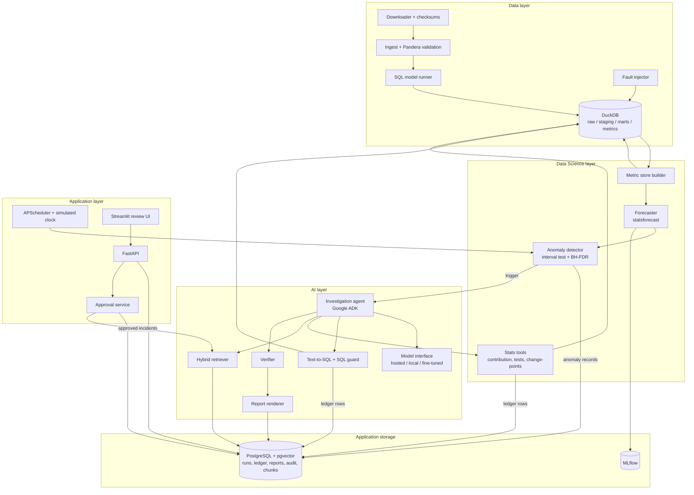
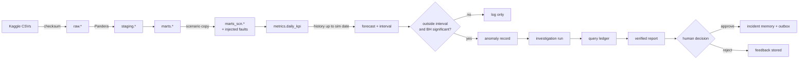
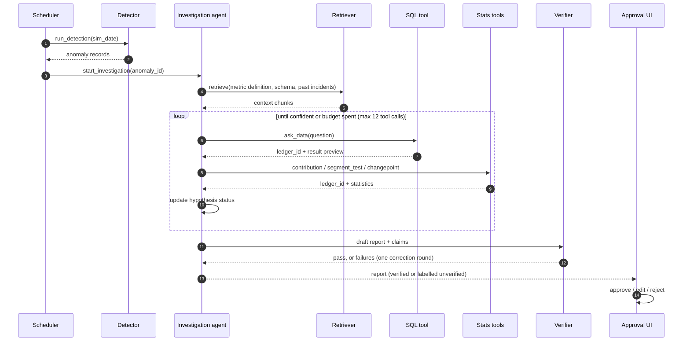
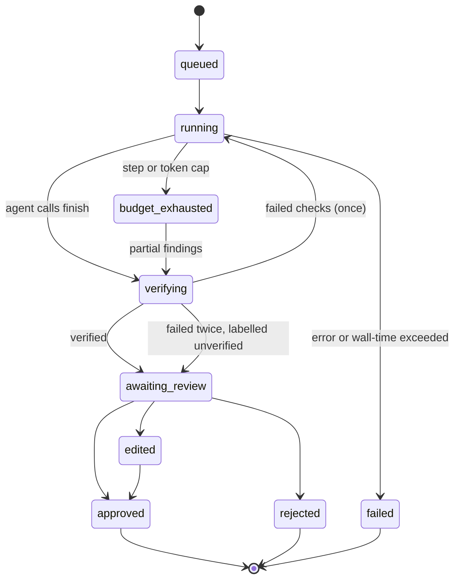
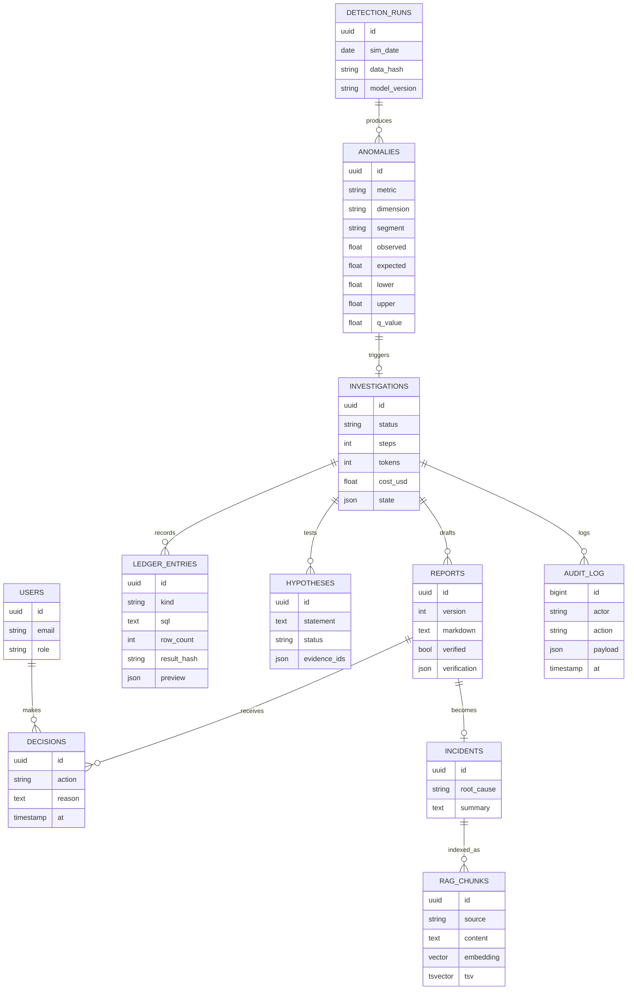
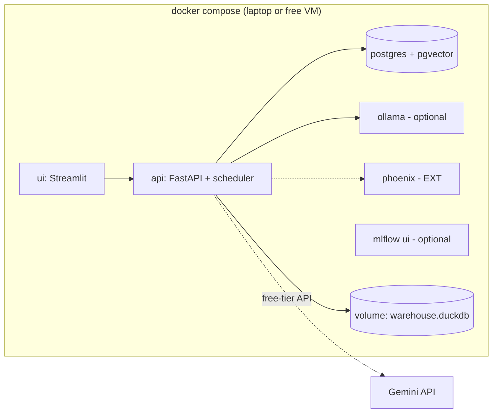

# System Architecture — MetricSentinel

> Status: Phase 0 planning document. This describes the **planned** design; nothing is implemented.
> Scope labels `[MVP]`, `[EXT]`, `[FUTURE]` as defined in `README.md`.

## 1. Architectural principles

1. **Deterministic core, narrow LLM use.** Data processing, detection, statistics, verification and publishing are plain, testable code. The LLM handles text-to-SQL, choosing the next hypothesis, and writing prose.
2. **Single agent.** One investigation agent with well-defined tools. Components talk through a persisted run state, not through agents chatting to each other.
3. **Evidence ledger.** Every number the system shows must come from a logged query or a logged statistical-tool result.
4. **Read-only by construction.** Agent tools cannot write. This is enforced by the database connection mode and by SQL parsing, not by prompt instructions.
5. **Human gate.** Only the approval service can publish.
6. **Replaceable models.** All LLM calls go through one model interface, configured per role (planner, SQL, writer), so hosted, local and fine-tuned models can be swapped.

## 2. Component view

### Component responsibilities

| Component | Responsibility | Type | Scope |
|---|---|---|---|
| Downloader | Fetch Olist files and verify checksums | Deterministic | MVP |
| Ingest + validation | Load raw tables; enforce Pandera schemas; write the quality report | Deterministic | MVP |
| SQL model runner | Build staging and marts from ordered SQL files | Deterministic | MVP |
| Fault injector | Create labelled anomalies in a scenario copy of the marts | Deterministic | MVP |
| Metric store builder | Compute daily KPI × dimension values with sample sizes | Deterministic | MVP |
| Forecaster | Produce expected values and prediction intervals | ML | MVP |
| Anomaly detector | Interval test, scoring, BH-FDR, grouping | Statistical | MVP |
| Stats tools | Contribution decomposition, segment tests, change-points | Statistical | MVP |
| Investigation agent | Generate and test hypotheses, rank root causes | LLM agent | MVP |
| Text-to-SQL + guard | Question → SQL; parse, validate, run read-only; write to the ledger | LLM + deterministic | MVP |
| Hybrid retriever | Full-text + vector search, RRF fusion (rerank in EXT) | Deterministic | MVP |
| Verifier | Match claims in the draft to ledger values | Deterministic (+ optional LLM check) | MVP |
| Report renderer | Markdown and chart generation from verified findings | Deterministic + LLM prose | MVP |
| Approval service | Approve / edit / reject; publish; write incident memory | Deterministic, human-driven | MVP |
| Scheduler | Advance the simulated day; run detection; queue investigations | Deterministic | MVP |

## 3. End-to-end data flow

In normal mode the scenario copy equals the clean marts (no injected faults). In evaluation mode, the fault injector writes both the modified data and a ground-truth label, which is hidden from the agent.

## 4. Investigation sequence

## 5. Run lifecycle

## 6. Backend

- **FastAPI** app with routers: `auth`, `kpis`, `anomalies`, `investigations`, `reports`, `admin`, `health`.
- A **service layer** holds the business logic; routers stay thin.
- **Background execution:** investigations run in a worker thread pool inside the API process (MVP), with state checkpointed to Postgres after every tool call. If a separate worker is ever needed, the service interface stays the same.
- **Configuration:** Pydantic Settings from environment variables. One YAML file for the metric catalogue and one for model roles.

### Planned REST API (v1)

| Method | Path | Purpose | Role | Scope |
|---|---|---|---|---|
| GET | `/health` | Liveness and dependency check | public | MVP |
| POST | `/api/v1/auth/token` | Issue a JWT | public | MVP |
| GET | `/api/v1/kpis` | Metric catalogue | viewer | MVP |
| GET | `/api/v1/kpis/{name}/series` | Daily values, forecast and interval | viewer | MVP |
| GET | `/api/v1/anomalies` | Filtered list of anomalies | viewer | MVP |
| GET | `/api/v1/anomalies/{id}` | Anomaly detail | viewer | MVP |
| POST | `/api/v1/investigations` | Start an investigation for an anomaly | analyst | MVP |
| GET | `/api/v1/investigations/{id}` | Run state, hypotheses, ledger, cost | viewer | MVP |
| GET | `/api/v1/reports/{id}` | Report with evidence | viewer | MVP |
| POST | `/api/v1/reports/{id}/decision` | Approve / edit / reject | approver | MVP |
| POST | `/api/v1/admin/sim/advance` | Advance the simulated day and run the cycle | admin | MVP |
| POST | `/api/v1/admin/scenarios/{id}/load` | Load an evaluation scenario | admin | MVP |
| POST | `/api/v1/ask` | Ad-hoc data question (ledger + verifier) | analyst | EXT |

All responses use Pydantic schemas. Errors use a single envelope: `{code, message, run_id?, details?}`.

## 7. Frontend

Streamlit app with four pages:

1. **Anomaly feed** — list by date and severity, with sparkline, expected vs observed values, and status.
2. **Investigation view** — hypotheses with status, tool-call timeline, ledger table with SQL, cost.
3. **Report review** — rendered report, evidence links, verifier result, and approve / edit / reject with reason.
4. **Admin** — advance the simulated day, load a scenario, view the latest eval summary.

The UI calls only the REST API. It never accesses a database directly.

## 8. Databases

**DuckDB (`warehouse.duckdb`)** — schemas `raw`, `staging`, `marts`, `marts_scn`, `metrics`. It is written only by the pipeline. The agent SQL tool opens it with `read_only=True`. See `DATA_PLAN.md`.

**PostgreSQL (`app`)** — application state:

`AUDIT_LOG` is insert-only. The application database user has no UPDATE or DELETE privilege on it.

## 9. AI/ML subsystem (summary)

Details are in `AI_ML_PLAN.md`.

| Role | Model | Scope |
|---|---|---|
| Forecasting | statsforecast models chosen per series family by backtest | MVP |
| Planner (agent) | Hosted free-tier Gemini Flash-class model; local fallback via Ollama | MVP |
| Text-to-SQL | Same hosted model with retrieved schema (MVP); fine-tuned local model if the gate says go (EXT) | MVP / EXT |
| Report prose | Hosted model, constrained to verified findings | MVP |
| Embeddings | Local multilingual small embedding model | MVP |
| Reranker | Local cross-encoder, kept only if measured to help | EXT |

## 10. Agent subsystem (summary)

One ADK LLM agent with 7 tools, hard budgets, and a persisted state object. Details are in `AGENT_WORKFLOW.md`.

## 11. Monitoring and observability

| Signal | Tool | Scope |
|---|---|---|
| Structured logs with `run_id`, `sim_date`, `component` | structlog → stdout (Docker logs) | MVP |
| Per-run cost, tokens, steps, latency | Stored in `INVESTIGATIONS`; shown in UI | MVP |
| Eval results over time | MLflow | MVP |
| LLM and tool traces | OpenTelemetry → Arize Phoenix | EXT |
| Service metrics (request rate, errors, run failures) | Prometheus + Grafana | OPT |
| Quality drift | Nightly eval job; alert if a gated metric drops | EXT |

## 12. Error handling

| Failure | Detection | Handling |
|---|---|---|
| Download or checksum mismatch | Checksum compare | Abort the pipeline; keep the previous warehouse |
| Validation failure (hard) | Pandera error | Abort the load; write the quality report; no metrics for that version |
| Validation warning (soft) | Pandera warning checks | Continue; flag it in the quality report and in detection context |
| Forecast fit failure for a series | Exception or NaN interval | Fall back to seasonal-naive; mark the series `fallback` |
| Too little history for a series | Sample-size check | Skip the series; do not test it |
| LLM timeout / rate limit | HTTP error / timeout | Exponential backoff (max 3); then the configured fallback model; then fail the run cleanly |
| Malformed LLM output | Pydantic validation | One re-ask with the validation error; then treat as a failed step |
| SQL rejected by the guard | sqlglot check | Return the reason to the agent; counts as a step |
| SQL runtime error | DuckDB exception | Up to 2 self-repair retries with the error message |
| Query timeout / row explosion | Time and row limits | Cancel; return "too broad" to the agent |
| Agent loop without progress | Step cap, repeated-call detector | Stop with `budget_exhausted`; report partial findings |
| Verifier failure | Claim mismatch | One correction round; then label the report "unverified" for review |
| Process crash during a run | Run heartbeat | On restart, runs stuck in `running` older than the timeout become `failed` |
| Postgres unavailable | Health check | API returns 503; the scheduler skips the cycle and logs it |

## 13. Security architecture (summary)

- **Layers of SQL defence:** read-only DuckDB connection → sqlglot allow-list → row and time limits → simulated-date filter injected into the query.
- **Untrusted data:** tool results are wrapped in delimited "data" blocks. Review text is truncated and marked untrusted. The system prompt tells the model to treat it as data only, and security tests check this.
- **No side-effect tools** are available to the agent.
- **Privacy:** customer identifiers are pseudonymised in staging. Hosted-LLM calls receive schema, aggregates and PII-scrubbed previews only.
- **Auth:** JWT with roles; approval restricted to `approver`; every decision is audited.

The full threat model is written in Phase 7 (`docs/THREAT_MODEL.md`, planned).

## 14. Deployment

- **Local:** `docker compose up`. GPU is not required.
- **Demo (EXT):** the same Compose stack on a free-tier VM, or the UI plus API on a Hugging Face Space, using the hosted LLM. Deployed only after the security gate passes (NFR-024).
- **Training (EXT):** Kaggle or Colab notebooks produce adapters, which are registered in MLflow and exported to GGUF for Ollama.
